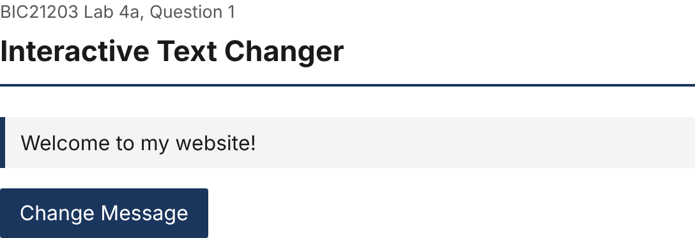
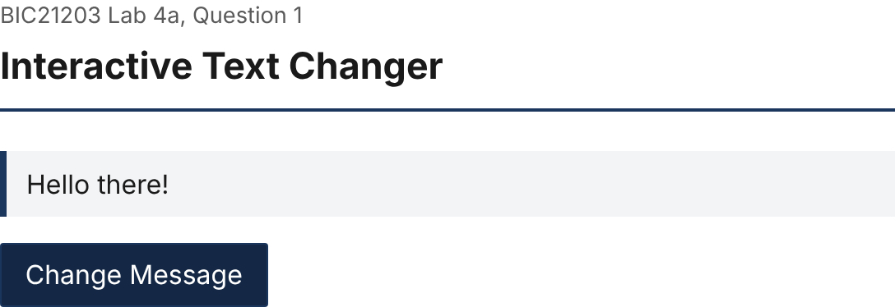
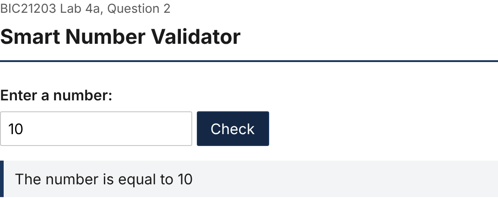
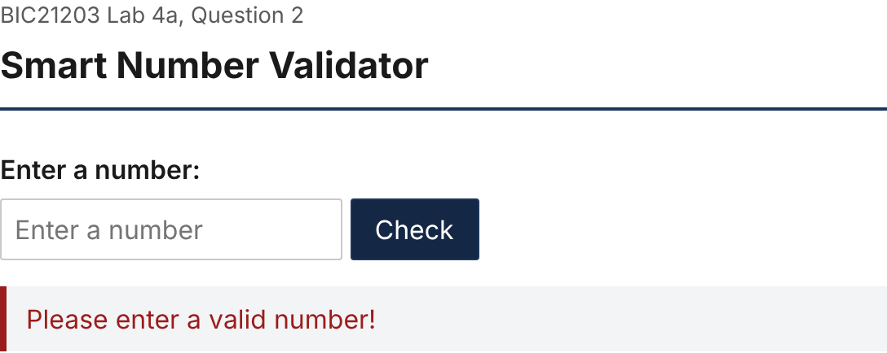
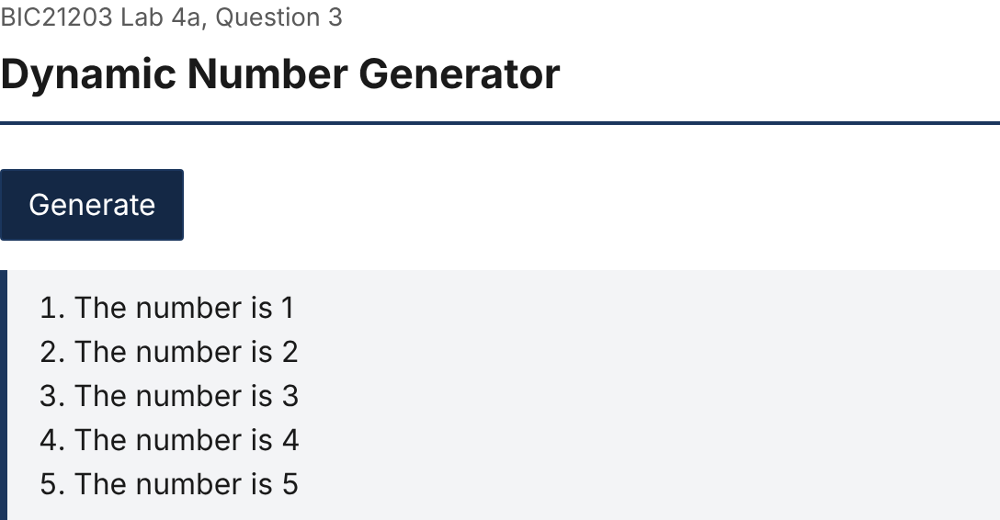

# BIC21203 Lab 4a: Client-Side Scripting (JavaScript)

Rezza bin Nor Azam Shah (AI240060), BIC21203 Web Development

Three small pages that use plain JavaScript (no libraries) to react to button clicks. Q1 swaps a paragraph's text, Q2 checks a typed value against 10, and Q3 builds a numbered list with a `for` loop. Each question has its own folder with an `index.html` and a `script.js`. The script is loaded with `defer`, so it runs after the page has been parsed and the elements it looks up already exist. All three pages share `style.css` in the root folder.

```
bic21203-lab4a-javascript/
├── index.html          links to the three questions
├── style.css
├── Q1/  index.html, script.js
├── Q2/  index.html, script.js
├── Q3/  index.html, script.js
└── screenshots/
```

## How to run

Nothing needs installing. Download or clone the repository, then open the page for the question in Chrome, Edge or Firefox:

- Q1: open `Q1/index.html`
- Q2: open `Q2/index.html`
- Q3: open `Q3/index.html`

You can also open the root `index.html` and follow the links. Double-clicking the file works. If you use VS Code, the Live Server extension works too.

## Q1: Interactive Text Changer

`script.js` gets the paragraph and the button with `document.getElementById()`. `changeMessage()` sets the paragraph's `textContent` to "Hello there!", and `addEventListener("click", changeMessage)` connects it to the button.

To test it, load the page and click **Change Message**.

| Before click | After click |
| --- | --- |
|  |  |

## Q2: Smart Number Validator

`checkInput()` reads the box, trims whitespace, and converts the text with `Number()`. An empty string or anything `Number.isFinite()` rejects counts as invalid. I used `Number()` and not `parseFloat()` because `parseFloat("10abc")` returns 10 and the bad input would get through. Valid numbers go through an `if...else if...else` chain comparing against 10. The message goes into `#result` with `textContent`. That paragraph has `role="status"` and `aria-live="polite"`, so screen readers announce each new result.

I tested it with these inputs:

| Input | Message shown |
| --- | --- |
| `5` | The number is lower than 10 |
| `10` | The number is equal to 10 |
| `15` | The number is higher than 10 |
| `abc` | Please enter a valid number! |
| (empty) | Please enter a valid number! |
| three spaces | Please enter a valid number! |
| `10.5` | The number is higher than 10 |

| 5 | 10 | 15 |
| --- | --- | --- |
|  |  |  |

| abc | empty | 10.5 |
| --- | --- | --- |
|  |  |  |

## Q3: Dynamic Number Generator

`generateNumbers()` first empties `#numberList` with `replaceChildren()`. A `for` loop then runs from 1 to 5, creating an `<li>` with `document.createElement()` on each pass, setting its text with `textContent` and appending it to the list. Because the list is cleared first, clicking **Generate** again replaces the items and doesn't add more.

To test it, click **Generate** once, then twice more.

| After 1 click | After 3 clicks (still 5 items) |
| --- | --- |
|  |  |